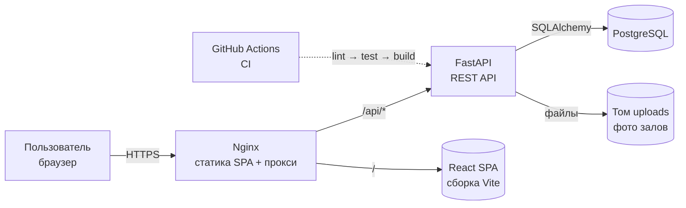
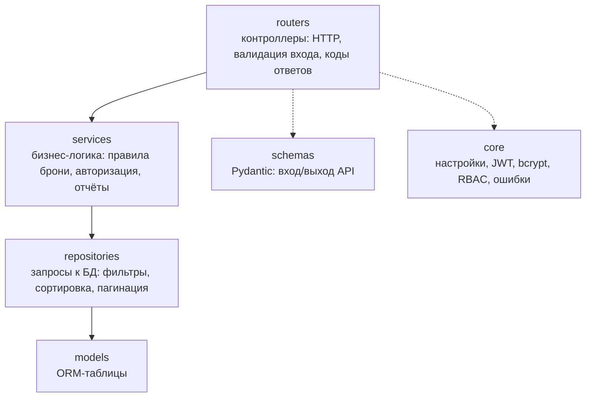
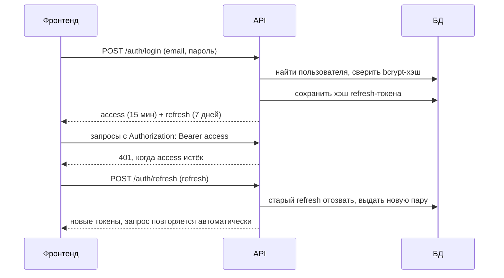

# Архитектура

Клиент-серверное приложение: SPA на React обращается к REST API на FastAPI, данные хранятся в PostgreSQL.

## Компоненты

В docker compose это три контейнера: `db`, `backend`, `frontend` (Nginx).
На бесплатном хостинге — один контейнер: FastAPI сам отдаёт собранный фронтенд (`Dockerfile` в корне).

## Слои бэкенда

- **routers** — только принимают запрос и вызывают сервис; бизнес-логики в контроллерах нет;
- **services** — правила предметной области (например, `validate_booking_time`, `can_change_status`), покрыты unit-тестами;
- **repositories** — все SQL-запросы через ORM с параметрами;
- **core/deps.py** — `get_current_user`, `require_roles(...)` для проверки прав на сервере;
- **core/errors.py** — единый формат ошибок `{"error": {"code", "message", "details"}}`.

## Слои фронтенда

| Папка | Назначение |
|---|---|
| `api/` | axios-клиент с автообновлением токена, типы, функции запросов |
| `auth/` | контекст текущего пользователя, защищённые маршруты |
| `components/` | UI-kit: таблица броней, календарь слотов, диалоги, состояния загрузки/пустого списка/ошибки |
| `pages/` | страницы; админские грузятся лениво отдельным файлом |
| `utils/` | расчёт слотов, форматирование, правила валидации |

Серверные данные кэширует TanStack Query; после изменений связанные запросы инвалидируются.

## Авторизация

## Бронирование: защита от пересечений

1. Сервис проверяет правила (время, длительность, вместимость) и наличие пересечения → `409 Conflict`.
2. Если два запроса пришли одновременно и оба прошли проверку, вторую вставку отклонит
   ограничение `EXCLUDE` в PostgreSQL → сервис превращает ошибку БД в тот же `409`.
