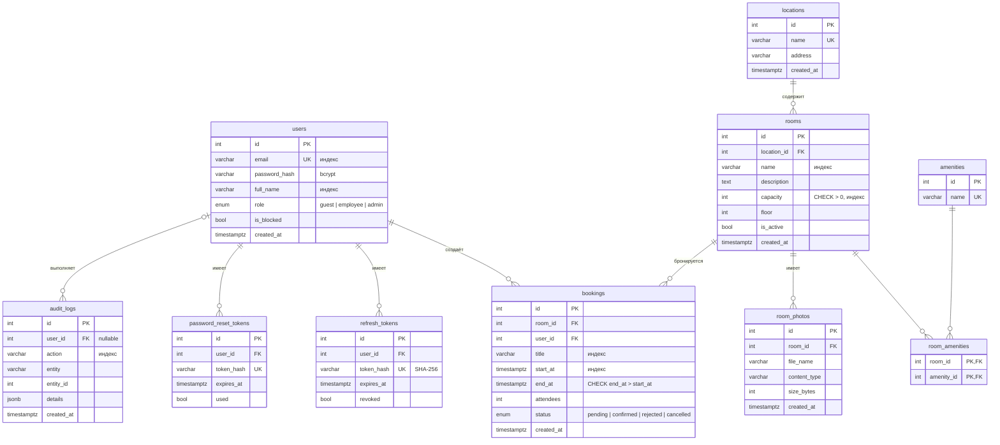

# ER-диаграмма базы данных

10 таблиц, третья нормальная форма. Связи 1:N и M:N, индексы на полях поиска и внешних ключах.
Диаграмма в формате Mermaid — GitHub рисует её автоматически.

## Ограничения целостности

| Ограничение | Таблица | Зачем |
|---|---|---|
| `bookings_no_overlap` — `EXCLUDE USING gist (room_id WITH =, tstzrange(start_at, end_at) WITH &&) WHERE status IN ('pending','confirmed')` | bookings | в одном зале не может быть двух активных броней на пересекающееся время |
| `bookings_time_order` — `CHECK (end_at > start_at)` | bookings | окончание позже начала |
| `rooms_capacity_positive` — `CHECK (capacity > 0)` | rooms | вместимость положительная |
| `ON DELETE RESTRICT` | rooms.location_id | нельзя удалить локацию, в которой есть залы |
| `ON DELETE CASCADE` | bookings, room_photos, room_amenities, tokens | при удалении зала/пользователя удаляются зависимые записи |
| `ON DELETE SET NULL` | audit_logs.user_id | журнал сохраняется после удаления пользователя |

## Почему 3НФ

- нет повторяющихся групп: удобства вынесены в отдельный справочник и связаны через `room_amenities`;
- каждый неключевой атрибут зависит только от ключа: адрес хранится в `locations`, а не в каждом зале;
- нет транзитивных зависимостей: в броне хранится только `room_id`, название зала берётся через связь.

Все изменения схемы — только через миграции Alembic (`backend/alembic/versions`).
